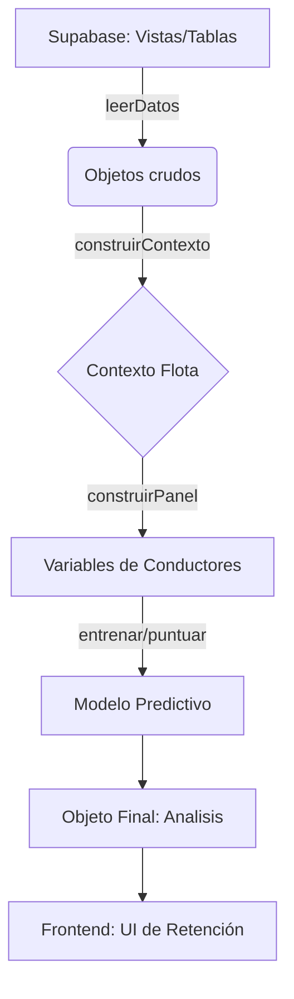

Esta es la documentación técnica del módulo `analisis-liquidacion`, diseñada bajo los estándares de arquitectura de software para un sistema SaaS/ERP de transporte.

---

# Documentación del Módulo: analisis-liquidacion

## 1. Visión General y Propósito
El módulo **analisis-liquidacion** es un componente crítico del sistema de Inteligencia de Negocios (BI) orientado a la retención de personal. Su propósito es realizar un análisis descriptivo y predictivo de la **deserción de conductores** basándose exclusivamente en datos transaccionales de liquidación mensual (`cierres_diarios`) y registros de novedades (accidentes, ausencias).

**Responsabilidades:**
- **Predictiva:** Evaluar la probabilidad de retiro de un conductor en los próximos 60 días usando modelos de regresión.
- **Descriptiva:** Generar métricas de desempeño, tasas de retiro por segmentos (tramos) y comparativas frente a la mediana de la flota (KPIs de ventas, eficiencia y comportamiento).
- **Imputación:** Normalizar datos de plata en periodos donde la información externa fue incompleta, permitiendo que el modelo siga siendo robusto.

## 2. Arquitectura y Estructura de Archivos

| Archivo | Rol | Propósito |
| :--- | :--- | :--- |
| `analisis.ts` | **Core Lógico** | Implementa las transformaciones, cálculos de variables, entrenamiento de modelos y construcción del objeto `Analisis`. |
| `datos.ts` | **Capa de Acceso** | Interfaz con Supabase. Gestiona la extracción paginada y transformación de los datos crudos hacia las interfaces del módulo. |

### Diagrama de Flujo Conceptual

## 3. Modelos de Datos y Entidades
El módulo se apoya en interfaces de TypeScript que reflejan vistas SQL específicas:

- `MesLiq`: Representa la vista `liquidacion_conductor_mes`. Contiene métricas financieras (bruto, neto, anticipos) y operativas (días, viajes, rutas).
- `NovedadMes`: Representa `novedades_conductor_mes`. Registra eventos negativos como viajes perdidos, ausencias y accidentes.
- `Contexto`: Estructura interna que almacena las **medianas de la flota** (por ruta, por clase de vehículo, globales). Es el "estándar de comparación" para el modelo.
- `FilaLiq`: Extensión de la interfaz genérica `Fila` (del módulo `riesgo`) que incluye variables calculadas para cada corte mensual.

## 4. Reglas de Negocio y Lógica Crítica

1.  **Horizonte de Predicción:** El modelo predice el retiro en los **60 días siguientes** al corte (día 1 de cada mes).
2.  **Ventana de Análisis:** Las variables utilizadas para la predicción observan los **3 meses calendario anteriores** al corte.
3.  **Imputación:** Si no hay valores financieros (ej. meses sin dato GEMA), se usa la **mediana de la flota** en lugar de ceros para evitar sesgos, manteniendo la integridad de las variables de "días y viajes".
4.  **Normalización:**
    *   Las ventas se comparan siempre contra la **mediana de su ruta + tipo de vehículo** (o solo ruta si el grupo es menor a 5).
    *   Los días trabajados se ajustan mediante `diasEquivalentes` si el conductor ingresó a mitad de mes.
5.  **Criterio de Inclusión:** Solo se procesan conductores activos en plantilla con historial de cierres previos.

## 5. Puntos de Entrada y Funciones Principales

- `leerDatos()`: Función asíncrona que orquesta la carga de datos desde Supabase mediante peticiones paralelas para optimizar el tiempo de respuesta.
- `analizar(...)`: El motor principal. Recibe la lista de conductores, datos de liquidación y novedades. Devuelve el objeto `Analisis` completo, incluyendo métricas del modelo (AUC, lift, etc.) y puntuación de conductores.
- `construirContexto(meses)`: Genera los *benchmarks* de la flota.
- `variables(...)`: Calcula el vector de características ($x$) para un conductor en un momento dado, realizando la normalización estadística frente a la mediana.

## 6. Integraciones y Dependencias

- **Supabase (Admin Client):** Única fuente de verdad. Se utiliza `createAdminClient` para acceso elevado.
- **`src/lib/riesgo/`**: El módulo depende fuertemente de las librerías compartidas de riesgo:
    - `modelo.ts`: Para la lógica de entrenamiento (regresión logística) y puntuación.
    - `panel.ts`: Para validación de estados de contratación (`enPlantilla`, `estaActivo`).
    - `fechas.ts`: Para manipulación de periodos (`mesMas`, `diasEntre`).
- **Migraciones SQL:** El sistema espera que existan las vistas `liquidacion_conductor_mes` y `novedades_conductor_mes` con esquemas compatibles a las interfaces definidas en `analisis.ts`.

---
*Nota: Este módulo es altamente sensible a la consistencia de los datos en las vistas de base de datos. Cualquier cambio en la estructura de `liquidacion_conductor_mes` debe replicarse en las interfaces del archivo `analisis.ts`.*