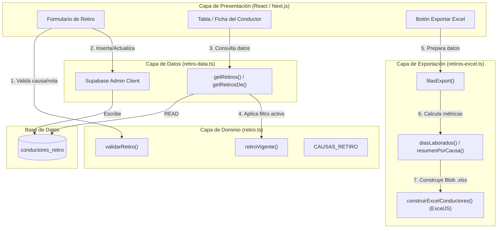
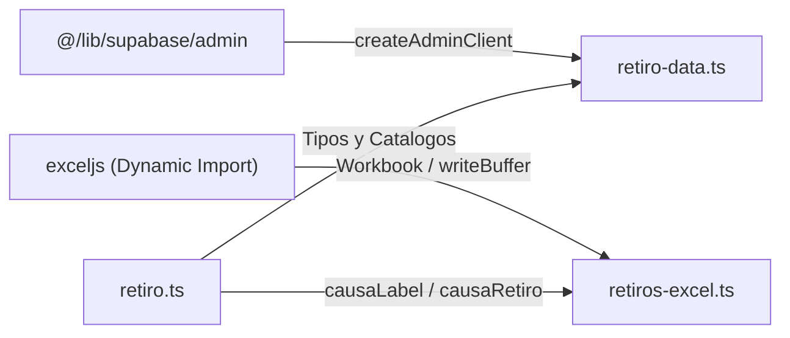

# Documentación del Módulo: conductores

## 1. Visión General y Propósito

### Resumen Ejecutivo
El módulo **`conductores`** gestiona la trazabilidad del ciclo de egreso (retiro) del personal de conducción dentro del sistema ERP/SaaS de transporte. Su función principal es registrar, validar y auditar las razones por las cuales un conductor deja de operar en la flota (renuncias, despidos, jubilaciones, etc.), proporcionando capacidades analíticas y de reporte para el departamento de Recursos Humanos (RRHH).

### Responsabilidades Principales
1. **Gestión del Catálogo de Causas de Retiro:** Administrar una taxonomía estandarizada de motivos de retiro clasificados por tipo (Voluntario, Empresa, Otro).
2. **Validación de Reglas de Negocio:** Garantizar la integridad de los datos capturados durante el proceso de desvinculación (longitud de notas, justificaciones obligatorias).
3. **Persistencia y Consulta Trazable:** Proveer métodos seguros en el servidor para consultar el historial de retiros registrados por cédula utilizando la infraestructura de Supabase.
4. **Resolución del Estado Vigente:** Determinar la causa activa de retiro correspondiente al periodo contractual actual del conductor.
5. **Generación de Analítica y Exportación:** Transformar los datos tabulares y métricas de desempeño (como días laborados) en reportes consolidados en formato Excel (`.xlsx`) estructurados con múltiples pestañas y resúmenes estadísticos.

---

## 2. Arquitectura y Estructura de Archivos

El módulo está diseñado bajo una arquitectura limpia con separación estricta entre la capa de dominio pura (compatible con cliente y servidor), la capa de datos (exclusiva del servidor) y la capa de infraestructura/exportación.

### Archivos Analizados

| Archivo | Capa / Rol | Entorno de Ejecución | Propósito Principal |
| :--- | :--- | :--- | :--- |
| `src/lib/conductores/retiro.ts` | **Dominio / Lógica Pura** | Universal (Cliente / Servidor) | Define tipos, constantes del catálogo (`CAUSAS_RETIRO`), validaciones y lógica de resolución de registros vigentes. |
| `src/lib/conductores/retiro-data.ts` | **Acceso a Datos (DAL)** | Solo Servidor (*Server-only*) | Consultas a la base de datos Supabase mediante `createAdminClient`, mapeo de filas DTO a dominio y manejo de paginación. |
| `src/lib/conductores/retiros-excel.ts` | **Exportación / Reporting** | Cliente (Navegador) | Mapeo de datos para exportación, cálculo de métricas (dias laborados, agrupación por mes) y generación de archivo Excel con `exceljs`. |

### Diagrama de Flujo Conceptual



---

## 3. Modelos de Datos y Entidades

### Interfaces y Tipos TypeScript Clave

```typescript
// Categorización general de las causas
export type TipoRetiro = "voluntario" | "empresa" | "otro";

// Definición de un elemento del catálogo
export interface CausaRetiro {
  clave: string;  // Identificador único persistido en BD (ej: "RENUNCIA_VOLUNTARIA")
  label: string;  // Descripción legible para interfaz
  tipo: TipoRetiro;
}

// Registro histórico o activo de retiro guardado
export interface RetiroRegistrado {
  cedula: string;
  fechaRetiro: string | null;
  causa: string;
  nota: string | null;
  registradoPor: string | null;
  registradoAt: string;
  actualizadoPor: string | null;
  actualizadoAt: string;
}

// Estructura intermedia para generación de Excel
export interface FilaRetiro {
  nombre: string;
  cedula: string;
  codigo: string;
  cargo: string;
  estado: string;
  celular: string;
  correo: string;
  fechaIngreso: Date | null;
  fechaRetiro: Date | null;
  mesRetiro: string;      // Formato "YYYY-MM"
  diasLaborados: number | null;
  tipoCausa: string;
  causa: string;
  nota: string;
  registradoPor: string;
  registradoEl: Date | null;
}
```

### Tablas de Base de Datos Interactuantes

El módulo interactúa directamente con la tabla **`conductores_retiro`** (creada en la migración `20261005214330`).

| Columna BD | Tipo de Dato DB | Mapeo TypeScript | Descripción de Negocio |
| :--- | :--- | :--- | :--- |
| `cedula` | `text` | `string` | Cédula/Identificación del conductor (Clave foránea conceptual). |
| `fecha_retiro` | `date / text` | `string \| null` | Fecha formal de desvinculación. |
| `causa` | `text` | `string` | Clave del catálogo `CAUSAS_RETIRO`. |
| `nota` | `text` | `string \| null` | Explicación detallada o justificación libre. |
| `registrado_por_email` | `text` | `string \| null` | Usuario de RRHH/Sistema que creó el registro. |
| `registrado_at` | `timestamptz` | `string` | Timestamp ISO de creación. |
| `actualizado_por_email` | `text` | `string \| null` | Último usuario que modificó el registro. |
| `actualizado_at` | `timestamptz` | `string` | Timestamp ISO de la última actualización. |

---

## 4. Reglas de Negocio y Lógica Crítica

### 1. Inmutabilidad de Claves del Catálogo
Las claves de `CAUSAS_RETIRO` (ej. `RENUNCIA_VOLUNTARIA`, `JUSTA_CAUSA`) quedan grabadas históricamente en la base de datos. Existe una directiva explícita en el código: **nunca se debe renombrar o modificar una clave existente** para evitar romper la integridad de registros antiguos. Las nuevas causas deben agregarse como nuevos elementos al arreglo.

### 2. Validaciones de Registro (`validarRetiro`)
Para guardar una causa de retiro, el sistema impone las siguientes reglas:
* **Pertenencia al Catálogo:** La causa seleccionada debe existir explícitamente dentro del catálogo mapeado (`POR_CLAVE.has(causa)`).
* **Regla Especial para Causa "OTRA":** Si el usuario selecciona la causa genérica `"OTRA"`, es **estrictamente obligatorio** ingresar una nota explicativa de mínimo 5 caracteres (después de aplicar `.trim()`).
* **Límite Operativo de Nota:** La nota no puede superar los **2,000 caracteres** (`NOTA_MAX`).

### 3. Resolución de Retiro Vigente (`retiroVigente`)
Un conductor puede tener múltiples registros históricos de retiro en la tabla. Para determinar cuál debe mostrarse en su ficha actual:
1. Se busca una coincidencia exacta donde `r.fechaRetiro === fechaRetiro` (la fecha de retiro que actualmente tiene la ficha del conductor).
2. Si no hay coincidencia exacta por fecha, se selecciona el registro con la fecha de modificación/actualización más reciente (`actualizadoAt`).

### 4. Tolerancia a Fallos en Migraciones (`getRetiros`)
En el método `getRetiros()`, si la tabla `conductores_retiro` aún no existe en el entorno o la migración de la base de datos no se ha ejecutado, el bloque no lanza una excepción fatal (`throw`), sino que retorna `{ disponible: false, porCedula: {} }`. Esto evita la degradación total de la pantalla principal de conductores.

### 5. Cálculo Normalizado de Fechas y Días Laborados (`diasLaborados` y `fechaExcel`)
* **Ajuste UTC para Excel:** La función `fechaExcel` convierte strings en formato `"YYYY-MM-DD"` a objetos `Date` instanciados explícitamente en UTC a medianoche (`Date.UTC`). Esto evita desfases de zona horaria (ej. que una fecha pase a mostrarse como el día anterior en clientes con GMT-5).
* **Métrica de Antigüedad:** `diasLaborados` calcula los días calendario absolutos transcurridos entre `fecha_ingreso` y `fecha_retiro`. Si la fecha de retiro es anterior a la fecha de ingreso o falta alguna de las dos, retorna `null`.

---

## 5. Puntos de Entrada y Funciones Principales

### Módulo: `retiro.ts`

#### `validarRetiro(causa: string, nota: string): string | null`
* **Entrada:** `causa` (clave a validar), `nota` (texto libre).
* **Salida:** `string` con el mensaje de error si falla la validación, o `null` si es válido.
* **Excepciones:** Ninguna.

#### `retiroVigente(registros: RetiroRegistrado[], fechaRetiro: string | null): RetiroRegistrado | null`
* **Entrada:** Arreglo de retiros asociados al conductor y la fecha de retiro activa en su perfil.
* **Salida:** El objeto `RetiroRegistrado` correspondiente o `null` si el arreglo está vacío.

---

### Módulo: `retiro-data.ts`

#### `getRetiros(): Promise<{ disponible: boolean; porCedula: Record<string, RetiroRegistrado[]> }>`
* **Propósito:** Lee masivamente todos los registros de la tabla `conductores_retiro` de forma paginada (bloques de 1,000 registros).
* **Salida:** Objeto indicando disponibilidad de la tabla y un mapa indexado por la cédula del conductor.
* **Seguridad:** Usa `createAdminClient()` (bypass RLS / ejecución exclusiva en servidor).

#### `getRetirosDe(cedula: string): Promise<{ disponible: boolean; registros: RetiroRegistrado[] }>`
* **Propósito:** Obtiene el historial exclusivo de retiros de un conductor según su cédula.

---

### Módulo: `retiros-excel.ts`

#### `filasExport<C extends ConductorExport>(conductores: C[], retiroDe: (c: C) => RetiroRegistrado | null): FilaRetiro[]`
* **Propósito:** Mapea el arreglo de conductores filtrados en pantalla a la estructura plana `FilaRetiro`. Realiza la discriminación entre conductores activos y retirados.

#### `resumenPorCausa(filas: FilaRetiro[]): ResumenCausa[]`
* **Propósito:** Agrupa los conductores retirados por su causa, calcula totales acumulados y los ordena descendentemente por frecuencia (posicionando "Sin registrar" al final).

#### `resumenPorMes(filas: FilaRetiro[]): ResumenMes[]`
* **Propósito:** Genera una matriz mensual de retiros agrupada por el mes de retiro (`YYYY-MM`), desglosando las cantidades por tipo de causa (Voluntario, Empresa, Otro, Sin Causa).

#### `construirExcelConductores(filas: FilaRetiro[], filtros: string[]): Promise<Blob>`
* **Propósito:** Construye un archivo Excel ejecutable en el navegador.
* **Parámetros:** `filas` (datos procesados), `filtros` (etiquetas de filtros aplicados en UI).
* **Salida:** `Promise<Blob>` con el binario del archivo `.xlsx` listo para descarga (`application/vnd.openxmlformats-officedocument.spreadsheetml.sheet`).
* **Características del libro generado:**
  * **Pestaña 1 ("Conductores"):** Listado detallado, formateo de fechas (`dd/mm/yyyy`), filas cebra alternadas, autofiltros y cabeceras estilizadas.
  * **Pestaña 2 ("Retiros por mes"):** Resumen consolidado mes a mes con totales.
  * **Pestaña 3 ("Resumen por causa"):** Distribución porcentual y métricas absolutas por causa.

---

## 6. Integraciones y Dependencias



1. **Supabase Admin Client (`@/lib/supabase/admin`):**
   * Empleado en `retiro-data.ts` mediante `createAdminClient()`.
   * Permite operaciones con el rol de administración de Supabase, sobrepasando las políticas RLS (*Row Level Security*) para garantizar la lectura de datos institucionales de RRHH en el servidor.

2. **ExcelJS (`exceljs`):**
   * Empleado en `retiros-excel.ts`.
   * Se importa dinámicamente mediante `await import("exceljs")` dentro de `construirExcelConductores`.
   * **Razón de Diseño:** Evita cargar el peso de la librería `exceljs` en el bundle principal de JavaScript inicial del cliente, cargándola bajo demanda únicamente cuando el usuario presiona el botón de exportación.