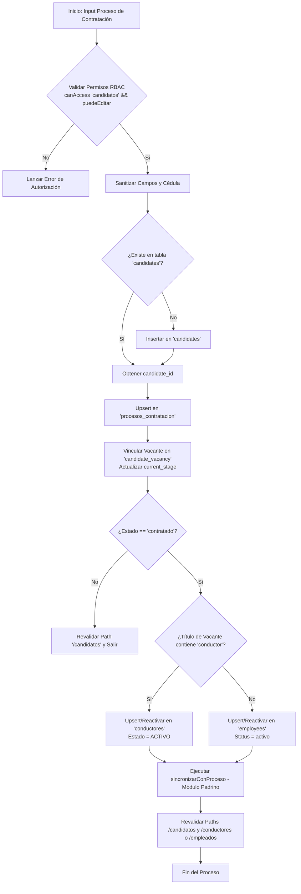

# Documentación del Módulo: contratacion

## 1. Visión General y Propósito

### Problema de Negocio
En las operaciones de transporte de pasajeros y carga terrestre en Colombia, la vinculación de personal operativo (principalmente conductores) y administrativo exige un control riguroso de cumplimiento legal, idoneidad técnica y mitigación de riesgos de seguridad vial. 

El módulo `contratacion` gestiona el embudo de selección y contratación, resolviendo los siguientes problemas críticos de la operación:
- **Validaciones Legales y de Tránsito:** Verificación obligatoria de infracciones de tránsito no subsanadas mediante el **SIMIT** (Sistema Integrado de Información sobre Multas y Sanciones por Infracciones de Tránsito) y antecedentes judiciales/disciplinarios antes de autorizar la vinculación.
- **Trazabilidad de Hitos Operativos:** Seguimiento escalonado de fases técnicas críticas para el transporte: exámenes médicos ocupacionales (fase 1 y 2), pruebas prácticas de manejo, inducción en escuela de capacitación y reconocimiento de rutas.
- **Transición Operativa Automática:** Conversión sin fricción de un aspirante calificado en un recurso activo del ERP (`conductores` o `employees`), garantizando la reactivación de personal en casos de reingreso y la sincronización con programas de acompañamiento operativo (módulo `padrino`).

### Responsabilidades Principales
1. **Gobierno del Ciclo de Vida del Proceso:** Administrar los estados del aspirante desde la postulación inicial hasta la contratación efectiva o el descarte documentado.
2. **Sincronización Bidireccional:** Mantener la coherencia de datos entre el pipeline de vacantes (`candidate_vacancy`), la base consolidada de personas (`candidates`) y el expediente del proceso (`procesos_contratacion`).
3. **Provisionamiento de Recursos Operativos (Alta de Personal):** Detectar automáticamente la naturaleza del cargo (conductor vs. cargo administrativo/taller) al momento de la contratación y aprovisionar el registro correspondiente en las tablas maestras operativas.
4. **Disponibilidad para Reportería:** Permitir la extracción masiva de datos (exportación a hojas de cálculo) respetando filtros de auditoría, fuentes de reclutamiento y fechas operativas.

---

## 2. Arquitectura y Estructura de Archivos

### Archivos Analizados

| Archivo | Rol en el Sistema | Propósito Técnico |
| :--- | :--- | :--- |
| `src/lib/contratacion/constants.ts` | Diccionario de Dominio | Define enumeraciones tipadas, esquemas de interfaz para lectura, opciones de interfaz visual (etiquetas, colores hexadecimales), catálogos SIMIT/antecedentes y configuración de filtros temporales. |
| `src/lib/contratacion/actions.ts` | Capa de Servicios / Mutaciones Server-Side | Implementa Server Actions de Next.js (`"use server"`). Ejecuta sanitización, control de acceso basado en roles (RBAC), transacciones orquestadas con Supabase Admin y disparadores hacia otros módulos de la aplicación. |

### Diagrama de Flujo Conceptual y Transición de Estados



---

## 3. Modelos de Datos y Entidades

### Interfaces TypeScript Clave

#### `ProcesoInput` (`src/lib/contratacion/actions.ts`)
Estructura de datos entrante para la creación o modificación de un proceso:
- `cedula` / `nombre`: Datos mínimos obligatorios de identificación.
- `simit`: Estado frente a infracciones (`ok`, `deuda`, `acuerdo_pago`, `pendiente`).
- `simit_valor`: Monto acumulado de la deuda por multas.
- `licencia_categoria`: Categorización del pase de conducción (ej. `C1`, `C2`, `C3` para servicio público).
- Fechas de ciclo operativo: `fecha_citacion`, `fecha_examenes`, `fecha_examenes_fase2`, `fecha_prueba_manejo`, `fecha_contrato`.

#### `ProcesoContratacion` (`src/lib/contratacion/constants.ts`)
Entidad completa persistida en base de datos. Extiende las propiedades de `ProcesoInput` agregando:
- `id`: Identificador único UUID.
- `candidate_id`: Clave foránea hacia la tabla maestra `candidates`.
- `vacancies`: Relación embebida para visualización (`{ title: string }`).
- Metadatos de auditoría: `created_at`, `updated_at`.

### Tablas de Base de Datos Intervenidas

```
+-----------------------------------------------------------------------------------+
| BASE DE DATOS SUPABASE (PostgreSQL)                                               |
+-----------------------------------------------------------------------------------+
|  [procesos_contratacion]                                                          |
|  - Entidad transaccional del módulo. Contiene el historial de contratación.       |
|                                                                                   |
|  [candidates]                                                                     |
|  - Directorio maestro de personas postuladas. Búsqueda y creación por documento.  |
|                                                                                   |
|  [candidate_vacancy]                                                              |
|  - Tabla pivote de seguimiento en el pipeline de selección por vacante.           |
|                                                                                   |
|  [vacancies]                                                                      |
|  - Consulta de metadatos del cargo postulado (title, department_id).               |
|                                                                                   |
|  [conductores]                                                                    |
|  - Catálogo operativo de flota de transporte. Se alimenta al contratar choferes. |
|                                                                                   |
|  [employees]                                                                      |
|  - Catálogo de nómina / planta administrativa o de mantenimiento.                 |
+-----------------------------------------------------------------------------------+
```

---

## 4. Reglas de Negocio y Lógica Crítica

### 1. Garantía de Identidad Única (`ensureCandidateId`)
- Todo proceso de selección debe estar anclado a un `candidate_id`.
- Se consulta `candidates` por `document_number` (cédula). Si el candidato no existe, se inserta automáticamente asignando como `source` el medio de postulación o el literal `"contratacion"`.
- **Tolerancia a fallos:** El fallo en la creación del candidato (`error`) retorna `null` y no interrumpe el registro del proceso operativo, permitiendo continuidad en contingencias.

### 2. Sanitización y Normalización de Datos (`sanitize`)
- **Nombres y Cédulas:** El nombre se normaliza a mayúsculas sostenidas (`toUpperCase()`) y se eliminan espacios en los extremos (`trim()`). La cédula se limpia de espacios residuales.
- **Gestión de Cierre:** El campo `causa_no_contrato` solo se conserva si el estado final es `"cierre"`; en cualquier otro estado, se resetea forzosamente a `null`.
- **Integridad Numérica:** El campo `simit_valor` es verificado mediante `Number.isFinite()`; cualquier valor no numérico o indefinido se colapsa a `0`.

### 3. Mapeo hacia el Pipeline de Selección (`linkCandidateToVacancy` / `ESTADO_TO_STAGE`)
El módulo sincroniza el estado operativo del proceso con la etapa visual del pipeline general de vacantes mediante el siguiente diccionario:
- `pendiente` $\rightarrow$ `recibido`
- `cierre` $\rightarrow$ `rechazado`
- El resto de los estados (`citado`, `en_examenes`, `en_examenes_fase2`, `prueba_manejo`, `en_escuela`, `reconocimiento_ruta`, `contratado`) se mapean 1:1.

### 4. Lógica de Alta Automática (`ensureAltaContratado`)
Al pasar un proceso al estado `"contratado"`:
- **Detección del Perfil:** Se evalúa el título de la vacante (`vacancies.title`). Se normaliza omitiendo marcas diacríticas/tildes y se evalúa la presencia de la subcadena `"conductor"`.
- **Ruta A: Conductor (Personal de Flota)**
  - Busca en la tabla `conductores` por cédula.
  - **Si ya existe:** Evalúa el estado. Si está diferente de `"ACTIVO"` (caso de reingreso), actualiza a `estado = 'ACTIVO'`, asigna `fecha_reingreso` y limpia `fecha_retiro`.
  - **Si no existe:** Realiza la inserción creando el conductor con categoría de licencia, cédula, nombre y `estado = 'ACTIVO'`.
- **Ruta B: Empleado (Personal Administrativo/Técnico)**
  - Busca en la tabla `employees` por `document_number`.
  - **Si ya existe:** Si se encuentra en estado `"retirado"` o `"inactivo"`, actualiza su estado a `"activo"` y limpia `end_date`.
  - **Si no existe:** Inserta un nuevo colaborador asociando el cargo (`position`), el departamento (`department_id`) y su enlace al candidato (`candidate_id`).
- **Fecha de Ingreso:** Se calcula con base en `fecha_contrato` o, en su ausencia, toma la fecha actual del sistema bajo la zona horaria legal de Colombia (`America/Bogota`).
- **Resiliencia Operativa:** Esta subrutina está protegida por un bloque `try/catch`; un error en el alta de personal en nómina no revierte el guardado del proceso de contratación, sino que delega la corrección a las tareas de conciliación posteriores (GEMA).

---

## 5. Puntos de Entrada y Funciones Principales

### `createProceso(input: ProcesoInput): Promise<{ id: string }>`
- **Propósito:** Crea un nuevo expediente de proceso de selección.
- **Parámetros:** Objeto con los datos capturados en el formulario de contratación.
- **Salida:** `{ id: string }` correspondiente al registro insertado en `procesos_contratacion`.
- **Validaciones y Errores:** 
  - Lanza excepción si el usuario no tiene permisos de edición sobre la entidad `"candidatos"`.
  - Lanza error si `nombre` o `cedula` están vacíos tras el `trim()`.

### `updateProceso(id: string, input: ProcesoInput): Promise<void>`
- **Propósito:** Actualiza la totalidad de los datos de un proceso existente.
- **Parámetros:** Identificador UUID del proceso y el payload con las modificaciones.
- **Efectos Secundarios:** Actualiza o inserta el candidato, actualiza el pipeline de la vacante, y si el estado muta a `"contratado"`, dispara el alta y la sincronización con el módulo de padrinos.

### `updateProcesoEstado(id: string, estado: string): Promise<void>`
- **Propósito:** Mutación rápida del ciclo de vida (utilizada en acciones rápidas de listas y tablas).
- **Parámetros:** `id` del proceso y nuevo `estado`.
- **Validaciones:** Comprueba que el estado exista dentro del array constante `PROCESO_ESTADOS`.
- **Comportamiento:** Si el estado cambia a algo distinto de `"cierre"`, remueve la causa de rechazo de forma automática en la base de datos.

### `deleteProceso(id: string): Promise<void>`
- **Propósito:** Eliminación lógica/física de un proceso.
- **Parámetros:** `id` del registro.
- **Seguridad:** Requiere verificación previa con `assertEditor()`.

### `exportarProcesos(f: ExportFilters): Promise<{ rows: Record<string, unknown>[]; error?: string }>`
- **Propósito:** Consulta no paginada optimizada para generación de reportes Excel.
- **Parámetros:** Filtros de búsqueda textual (`q`), estado, medio de captación y delimitación por rango de fechas (`desde`, `hasta`) aplicando sobre la fecha de creación o de citación.
- **Límites:** Fija un tope de seguridad operacional (`EXPORT_MAX = 5000`) para evitar desbordamientos de memoria en el servidor.

---

## 6. Integraciones y Dependencias

```
src/lib/contratacion/
 ├── actions.ts
 └── constants.ts
       │
       ├──> @/lib/supabase/admin (createAdminClient)
       │    └── Conexión con privilegios elevados para omitir RLS en inserciones cruzadas.
       │
       ├──> @/lib/permissions (getCurrentPermissions, canAccess)
       │    └── Validación de privilegios del usuario para el módulo "candidatos".
       │
       ├──> @/lib/padrino/servidor (sincronizarConProceso)
       │    └── Vinculación al programa de acompañamiento operativo para nuevos conductores.
       │
       └──> next/cache (revalidatePath)
            └── Invalida la caché de rutas Next.js: '/candidatos', '/conductores', '/empleados'.
```

### Detalle de Integraciones Externas e Internas
1. **Supabase Admin Client (`createAdminClient`):** Las acciones se ejecutan bajo el cliente de servicio administrativo. Esto es necesario debido a que la contratación involucra mutaciones transaccionales en tablas que cruzan dominios de seguridad dispares (`procesos_contratacion`, `conductores`, `employees`, `candidates`, `candidate_vacancy`).
2. **Módulo de Padrinazgo (`sincronizarConProceso`):** Cuando un proceso culmina en contratación (`estado === "contratado"`), se invoca esta integración para asignar o preparar al nuevo conductor dentro del esquema de mentoría y entrenamiento en ruta.
3. **Módulo de Permisos Centralizado (`getCurrentPermissions`):** Verifica que la sesión cuente con permisos activos de lectura/escritura sobre el recurso `"candidatos"`.
4. **Módulo de Sincronización Externa (GEMA):** El diseño del código está desacoplado para coexistir con el software de nómina/gestión de transporte externo ("GEMA"). Las altas automáticas insertan los datos mínimos operativos (`cedula`, `nombre`, `estado`), permitiendo que el proceso de sincronización por lotes de GEMA actualice los campos restantes sin provocar colisiones ni inconsistencias de llaves primarias.