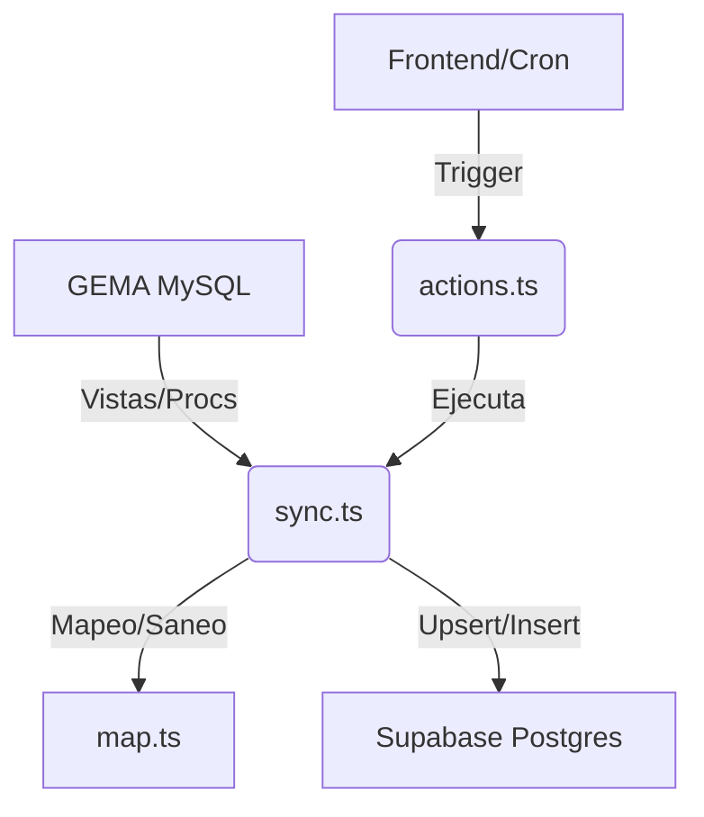

Esta documentación técnica describe el módulo **`gema`**, el cual actúa como la capa de integración de datos entre el sistema externo "GEMA" (base de datos MySQL de transporte) y el ERP basado en Supabase (PostgreSQL).

---

# Documentación del Módulo: gema

## 1. Visión General y Propósito
El módulo `gema` es un **middleware de sincronización de datos** que permite al ERP mantener una copia local (y procesable) de la información operativa de la empresa de transporte.
*   **Problema que resuelve:** GEMA es el sistema legacy de origen de los datos operativos (despachos, recaudos, telemetría). Este módulo soluciona la latencia y la inaccesibilidad de la base de datos de producción de GEMA, consolidando datos para los módulos de tesorería, liquidación, cumplimiento y monitoreo de flota.
*   **Responsabilidades:**
    *   Extraer datos desde vistas y procedimientos almacenados en MySQL.
    *   Transformar y normalizar tipos de datos (saneo de fechas, cédulas y strings).
    *   Persistir datos en Supabase con lógica de **upsert** (idempotencia) o **reemplazo por día**.
    *   Gestionar estados de sincronización (`gema_sync_state`) para evitar reprocesos innecesarios.

## 2. Arquitectura y Estructura de Archivos

| Archivo | Rol | Propósito |
| :--- | :--- | :--- |
| `actions.ts` | Server Actions | API para el frontend: sincronización manual y estado del sistema. |
| `client.ts` | Data Access | Configuración del pool de conexión a MySQL y utilidades base (query/proc). |
| `map.ts` | Transformer | Utilerías de limpieza y normalización de datos. |
| `sync.ts` | Orchestrator | Lógica principal de negocio: extracción, transformación y carga (ETL). |

**Diagrama de Flujo:**

## 3. Modelos de Datos y Entidades
*   **Interfaces Clave:**
    *   `SyncResult`: Contiene el nombre del dataset, número de filas procesadas y posibles errores.
    *   `EstadoSyncGema`: Estado de la última ejecución por dataset almacenado en Supabase (`gema_sync_state`).
*   **Tablas Destino:**
    *   **Maestros:** `conductores`, `propietarios`, `employees`, `vehiculos`.
    *   **Operacionales:** `cierres_diarios`, `ingreso_tercero`, `viajes_recaudados`, `velocidades`, `puntos_virtuales`, `historico_despacho`, `abonos`, etc.

## 4. Reglas de Negocio y Lógica Crítica
*   **Idempotencia:** Se prioriza el uso de `upsert` basado en llaves únicas (ej. `cedula` en conductores, `codigo` en vehículos) para permitir re-sincronizaciones sin duplicados.
*   **Reemplazo por Día:** Para datasets sin llave única estable (anotaciones, cumplimientos, abonos), el módulo utiliza un proceso de borrado/inserción atómico por día (función `gema_reemplazar_dia`).
*   **Ventanas de Sincronización:**
    *   **Incremental (45 días):** Utilizada por los datasets de cierre para absorber cambios retroactivos en recaudos.
    *   **Telemetría:** `puntos_virtuales` procesa datos basándose en una ventana de tiempo (deadline) para no exceder los límites de ejecución del servidor (ej. Vercel 300s).
*   **Flexibilidad de Columnas:** Dada la evolución del esquema en GEMA, se utilizan funciones de búsqueda dinámica para campos como `descuentos_otros` y `observaciones_descuento`, lo que evita errores si cambian los nombres de las columnas en la DB origen.

## 5. Puntos de Entrada y Funciones Principales

| Función | Descripción | Excepciones |
| :--- | :--- | :--- |
| `sincronizarGema()` | Ejecuta el proceso de sync completo (solo Admin). | Valida permisos, retorna `ok: false` si falla. |
| `recargarIngresoTerceroMes(mes)` | Sincroniza un mes histórico específico. | Fuera de rango o permisos insuficientes. |
| `runSync(ini, fin)` | Orquestador principal que invoca los flujos de ETL. | Puede lanzar errores de conexión o SQL. |
| `syncPuntosVirtuales(...)` | ETL especializado para telemetría con límite de tiempo. | Falla si el deadline se agota o RPC falla. |

## 6. Integraciones y Dependencias
*   **Supabase Admin Client:** Utilizado para la persistencia en Postgres mediante credenciales privilegiadas (`service_role`).
*   **MySQL2:** Cliente para comunicación con la base de datos legacy `gema_cr`.
*   **Variables de Entorno:**
    *   `GEMA_DB_*`: Credenciales de conexión a MySQL.
    *   `GEMA_SYNC_LOOKBACK_DIAS`: Configuración de la ventana temporal de sincronización.
    *   `GEMA_SYNC_BUDGET_MS`: Presupuesto de tiempo para la ejecución de scripts.
*   **Servicios Externos:** Depende estrictamente de la disponibilidad y conectividad con la red interna/VPN donde reside el servidor MySQL de GEMA.