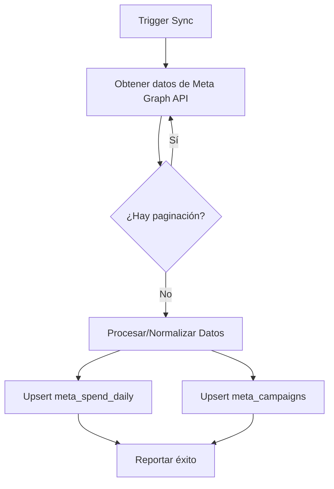

Esta documentación técnica describe la arquitectura y lógica operativa del módulo `meta`, diseñado para la integración y sincronización de métricas de publicidad con Meta Ads (Facebook/Instagram) dentro de la infraestructura del SaaS.

---

# Documentación del Módulo: meta

## 1. Visión General y Propósito
El módulo `meta` actúa como un puente de datos entre la plataforma de anuncios de Meta y el sistema interno de gestión de transporte. Su propósito fundamental es centralizar la visibilidad del **rendimiento de marketing**.

- **Problema de negocio:** Permite a los administradores del SaaS correlacionar la inversión publicitaria en tiempo real con la generación de leads, facilitando el cálculo del **Costo por Lead (CPL)** y la eficiencia de las campañas de captación de clientes para la operación de transporte.
- **Responsabilidades:**
    - Autenticación y consumo seguro de la Graph API de Meta.
    - Normalización de datos de rendimiento (gasto, impresiones, clics, leads).
    - Persistencia sincronizada en la base de datos (Supabase) con estrategias de *Upsert* para mantener la integridad histórica.

## 2. Arquitectura y Estructura de Archivos

| Archivo | Rol | Propósito |
| :--- | :--- | :--- |
| `src/lib/meta/sync.ts` | Servicio/Worker | Contiene la lógica de extracción, transformación (ETL) y carga (upsert) en la base de datos. |

### Diagrama de Flujo Conceptual

## 3. Modelos de Datos y Entidades

### Interfaces TypeScript (`MetaInsight`)
Representa la respuesta cruda de la API de Meta:
- `campaign_id`, `campaign_name`: Identificadores únicos de campaña.
- `spend`, `impressions`, `clicks`: Métricas numéricas (recibidas como string).
- `actions`: Arreglo de objetos con tipos de conversión específicos (leads/mensajes).

### Interacción con Base de Datos (Supabase)
El módulo interactúa con dos tablas principales mediante `adminClient` (acceso con privilegios elevados):
1. **`meta_spend_daily`**: Almacena el histórico diario de rendimiento. Clave única compuesta: `(fecha, meta_campaign_id)`.
2. **`meta_campaigns`**: Almacena el consolidado histórico/agregado por campaña. Clave única: `meta_campaign_id`.

## 4. Reglas de Negocio y Lógica Crítica

- **Normalización de Leads:** Existe una función `leadsFromActions` que actúa como filtro lógico. Considera "leads" únicamente a eventos que cumplan con criterios de conversión de Meta específicos:
    - `onsite_conversion.messaging_conversation_started_7d`
    - `lead`
    - `onsite_conversion.lead_grouped`
- **Estrategia de Actualización:** Se utiliza un patrón de **Idempotencia** mediante `upsert`. Si los datos para una fecha o ID de campaña ya existen, se actualizan (reemplazan) en lugar de crear duplicados.
- **Resiliencia de Paginación:** El módulo implementa un límite de seguridad de 50 páginas (o 25,000 registros, dada la configuración de `limit: 500`) para evitar bucles infinitos en caso de respuestas inesperadas de la API.

## 5. Puntos de Entrada y Funciones Principales

### `syncMetaAds(since: string, until: string)`
Es la función exportada principal.
- **Parámetros:**
    - `since` (string): Fecha inicio formato `YYYY-MM-DD`.
    - `until` (string): Fecha fin formato `YYYY-MM-DD`.
- **Salida:** `Promise<{ campañas: number; dias: number }>` — Objeto con el recuento de registros afectados.
- **Excepciones:**
    - Lanza `Error` si no se encuentran las variables de entorno (`META_ACCESS_TOKEN` o `META_AD_ACCOUNT_ID`).
    - Lanza `Error` si la comunicación con Meta API falla o si el `upsert` a la base de datos devuelve un error.

## 6. Integraciones y Dependencias
- **Meta Graph API (`v21.0`):** Fuente primaria de datos.
- **Supabase (Admin Client):** Dependencia de persistencia para el sistema. Requiere `service_role` o permisos similares para ejecutar los `upsert`.
- **Variables de Entorno:**
    - `META_ACCESS_TOKEN`: Credencial de acceso (debe ser token de larga duración o App Token).
    - `META_AD_ACCOUNT_ID`: ID del contenedor publicitario.
    - `META_API_VERSION`: Parametrización opcional para control de versiones de la API.