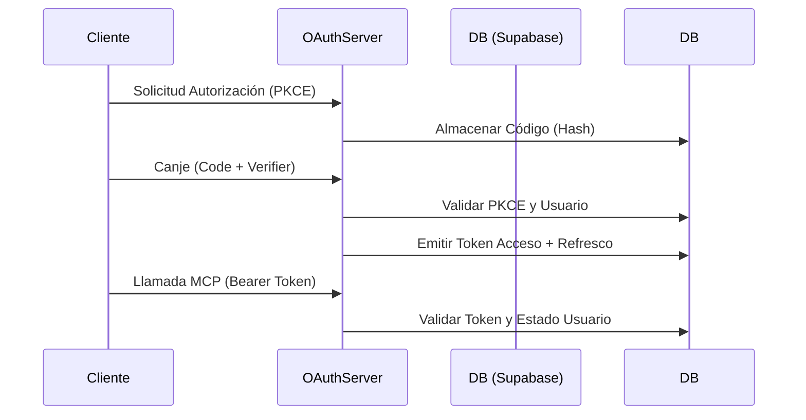

Esta es la documentación técnica del módulo `oauth` para el sistema de transporte (SaaS/ERP), diseñada bajo estándares de arquitectura de software para facilitar su mantenimiento y escalabilidad.

---

# Documentación del Módulo: oauth

## 1. Visión General y Propósito
El módulo `oauth` implementa un servidor de autorización **OAuth 2.1** diseñado para proteger el **MCP (Model Context Protocol)** del sistema.
- **Problema de negocio:** Permite que agentes externos (IA o aplicaciones cliente) se conecten de forma segura a los datos del ERP, garantizando que el usuario final mantenga el control total del acceso y que la integración sea auditable y revocable.
- **Responsabilidades:**
    - Registro dinámico de clientes (agentes).
    - Gestión del ciclo de vida de autorizaciones (códigos, tokens de acceso y refresco).
    - Implementación de seguridad avanzada: **PKCE (Proof Key for Code Exchange)** y rotación de tokens con detección de reuso.
    - Validación de permisos basada en el "tipo de usuario" del sistema Gestivo.

## 2. Arquitectura y Estructura de Archivos

| Archivo | Rol | Propósito |
| :--- | :--- | :--- |
| `config.ts` | Utilidades | Lógica pura de criptografía, constantes (tiempos, prefijos), esquemas de metadatos RFC y validación de URIs. |
| `servicio.ts` | Dominio / IO | Orquestación con Base de Datos (Supabase), lógica de negocio OAuth y gestión de concesiones. |

**Diagrama de Flujo Conceptual:**

## 3. Modelos de Datos y Entidades

### Tipos Clave (TypeScript)
- `ClienteOAuth`: Define el perfil del agente (ID, URIs permitidas, secretos hasheados).
- `RespuestaTokens`: Estructura estándar (`Bearer`) retornada tras el canje de código.
- `IdentidadOAuth`: Contexto extraído al validar un token de acceso (concesión, usuario, cliente).

### Interacción con Base de Datos (Supabase)
- **`oauth_clientes`**: Registro de agentes autorizados.
- **`oauth_codigos`**: Almacena los códigos de autorización temporales (con `codigo_hash` para seguridad).
- **`oauth_concesiones`**: Mapeo relacional entre `usuario_id` y `cliente_id`. Es el núcleo para revocaciones.
- **`oauth_tokens`**: Almacena tokens de acceso y refresco (hash de seguridad).

## 4. Reglas de Negocio y Lógica Crítica
- **Seguridad PKCE:** Obligatoria en el flujo de autorización (`S256`).
- **Control de Acceso:** Se valida `puedeConectarAgentes(usuarioId)` durante el canje y refresco de tokens. Si un usuario pierde su tipo en el ERP, sus tokens asociados se invalidan.
- **Rotación de Tokens:** Al usar `refresh_token`, el módulo detecta si un token ya fue usado (posible robo). Si ocurre un uso fuera de la ventana de gracia (`GRACIA_REUSO_MS`), se revoca la concesión completa.
- **Seguridad en URIs:** Bloqueo explícito de esquemas peligrosos (`javascript:`, `file:`, etc.) y restricción de `http:` solo a `localhost` (RFC 8252).
- **Eficiencia:** Se utiliza `timingSafeEqual` para comparaciones de hashes y una escritura diferida (cada 5 min) para el `ultimo_uso_at` de la concesión para reducir carga en base de datos.

## 5. Puntos de Entrada y Funciones Principales

| Función | Parámetros | Propósito |
| :--- | :--- | :--- |
| `registrarCliente` | `Record<string, unknown>` | Crea un nuevo agente (RFC 7591). |
| `validarSolicitudAutorizacion` | `params`, `mcpUrl`, `base` | Valida parámetros de entrada (`redirect_uri`, `scope`, `PKCE`). |
| `canjearCodigo` | `cliente`, `form` | Intercambia código por `access_token` y `refresh_token`. |
| `refrescarTokens` | `cliente`, `form` | Emite nuevos tokens ante la expiración, aplicando lógica de rotación. |
| `validarTokenAcceso` | `token` | Verifica si el token es válido, no revocado y vigente (usado por el MCP). |

*Nota: Todas las funciones de mutación de estado lanzan `ErrorOAuth` en caso de fallo, facilitando un manejo centralizado mediante `aRespuesta()`.

## 6. Integraciones y Dependencias
- **Supabase (Admin Client):** Única fuente de persistencia para clientes, códigos y tokens.
- **`src/lib/external/acceso.ts`:** Dependencia crítica. El módulo OAuth consulta esta capa para verificar si el `usuarioId` sigue habilitado para operar con agentes.
- **RFC Compliance:**
    - RFC 7636 (PKCE)
    - RFC 8414 (Metadatos del Servidor de Autorización)
    - RFC 7009 (Revocación)
    - RFC 8707 (Indicador de recursos)