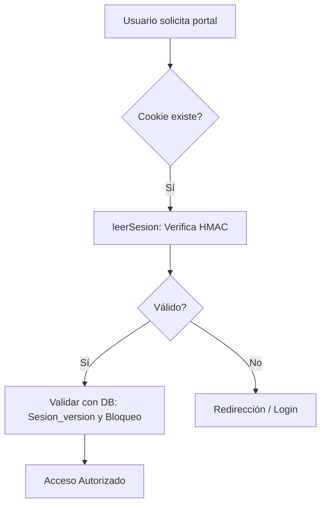

Esta es la documentación técnica del módulo `portal-afiliados`, diseñada bajo estándares de arquitectura de software para sistemas de gestión empresarial.

---

# Documentación del Módulo: portal-afiliados

## 1. Visión General y Propósito
El módulo `portal-afiliados` es un subsistema crítico de seguridad y autenticación diseñado para proveer a los propietarios de vehículos (afiliados) acceso seguro a su información operativa dentro del SaaS/ERP.

*   **Problema de Negocio:** Permite la descentralización de la información de transporte, reduciendo la carga operativa del equipo de Tesorería al delegar consultas (extractos, estados de cuenta, etc.) a los usuarios finales de forma segura y auditada.
*   **Responsabilidades Principales:**
    *   Gestión de identidades independientes de Supabase Auth (sistema de autenticación nativo).
    *   Implementación de seguridad de contraseñas de alta complejidad (scrypt).
    *   Control de acceso estatal basado en sesiones `HttpOnly` firmadas.
    *   Auditoría completa de actividades (bitácora de accesos).

## 2. Arquitectura y Estructura de Archivos

| Archivo | Rol | Propósito |
| :--- | :--- | :--- |
| `clave.ts` | Utilidad / Seguridad | Lógica de hashing (scrypt) y validación de contraseñas. |
| `cuentas.ts` | Acceso a Datos | Consultas para el panel de administración (Tesorería). |
| `servidor.ts` | Orquestador | Gestión de cookies, estado de sesión y registro de logs. |
| `sesion.ts` | Core / Seguridad | Implementación de tokens firmados (HMAC-SHA256). |

### Diagrama de Flujo (Sesión)

## 3. Modelos de Datos y Entidades

### Tipos TypeScript clave
*   **`CuentaPortal`**: Entidad de sesión activa. Contiene `id`, `cedula`, `email` y flags de seguridad (`debeCambiarClave`).
*   **`CargaSesion`**: Estructura del payload del token: `{c: id, v: version, e: expiracion}`.

### Entidades de Base de Datos
1.  **`afiliado_cuentas`**: Maestro de usuarios. Almacena `clave_hash` (formato `scrypt$N$r$p$sal$hash`), `sesion_version` (para invalidación instantánea) y `bloqueado_hasta`.
2.  **`afiliado_accesos`**: Bitácora. Registra IP, equipo y detalles del evento (ej. `ingreso_fallido`, `exportacion`).
3.  **`afiliado_portal_config`**: Tabla de configuración global (almacena el `secreto_sesion` para el firmado de tokens).

## 4. Reglas de Negocio y Lógica Crítica

*   **Seguridad de Contraseñas:** Se utiliza `scrypt` con parámetros (`N=16384`, `r=8`, `p=1`). El formato de almacenamiento es portable, permitiendo aumentar la complejidad del costo en el futuro.
*   **Protección contra Fuerza Bruta:** 
    *   Tras 5 intentos fallidos (`INTENTOS_MAXIMOS`), la cuenta se bloquea por 15 minutos (`BLOQUEO_MIN`).
*   **Gestión de Sesiones:**
    *   **Invalidez por versión:** Si la `sesion_version` en la base de datos es mayor que en el token, la sesión se invalida inmediatamente.
    *   **Independencia:** El sistema de sesión usa cookies `HttpOnly` firmadas con un secreto gestionado desde la DB (`afiliado_portal_config`) o variables de entorno, evitando dependencia exclusiva de proveedores externos.
*   **Validación de Clave Nueva:** No se permite el uso del prefijo del correo electrónico en la contraseña.

## 5. Puntos de Entrada y Funciones Principales

*   **`verificarClave(clave, guardado)`**: Compara el hash con la entrada usando `timingSafeEqual` para prevenir ataques de temporización (*timing attacks*).
*   **`getCuentaPortal()`**: Función asíncrona principal para verificar la autenticidad de la petición en cada página del portal. Retorna `null` si la sesión no es válida.
*   **`registrarAcceso(e)`**: Función de logging resiliente. Si ocurre un error al escribir en la bitácora, el error se captura y se loguea en la consola del servidor para no interrumpir el flujo del usuario.
*   **`generarClaveProvisional()`**: Genera cadenas alfanuméricas legibles (ej: `ABCD-1234-EFGH`), excluyendo caracteres ambiguos para facilitar la comunicación telefónica.

## 6. Integraciones y Dependencias

*   **Supabase Admin (`createAdminClient`)**: El módulo utiliza privilegios de `service_role` para lectura y escritura, garantizando que el acceso a la tabla de configuración y cuentas no esté limitado por políticas RLS estándar del front-end.
*   **Node.js Crypto**: Dependencia nativa para HMAC y cifrado, garantizando que el módulo sea robusto y libre de dependencias npm de terceros para criptografía.
*   **`src/lib/devengados/audit`**: Dependencia para obtener metadatos de la petición (`IP`, `equipo`), asegurando consistencia en la auditoría del sistema de transporte.