# Documentación del Módulo: Recobros (Tesorería)

## 1. Visión General y Propósito

Un **recobro** es el cobro al conductor de las timbradas que no registró en un
viaje: el video de la cámara (o la revisión de la cartulina) muestra más
pasajeros de los que marcó la registradora. El módulo sigue cada recobro de
principio a fin, desde la solicitud de revisión hasta el pago, según el
requerimiento de Tesorería del 28-oct-2026.

Todo se ve en una sola página, **`/tesoreria/recobros`**:

- **Resumen** del periodo (semana, mes, mes anterior o todo) y por tipo.
- **Flujo** de estados: al tocar uno se filtra la bandeja.
- **Bandeja** con semáforo, filtros rápidos, búsqueda, rango de fechas, orden por urgencia y Excel (hojas Bandeja y Gestiones).
- **Rankings** de conductores y busetas con más timbradas no registradas.
- **Detalle lateral:** datos del viaje, línea de tiempo, historial del conductor y las acciones del rol de quien mira.

Mantenimiento resuelve las revisiones de cámara en **Mantenimiento › Cámaras y
sensores › Solicitudes**.

## 2. Flujo

```mermaid
graph TD
    A[Abono «REVISIÓN CÁMARA» en GEMA] --> S[Solicitud creada]
    C[Auxiliar: Enviar a revisión de cámaras] --> S
    M[Mantenimiento: camara_recobro con conteo] --> R
    S -->|Mantenimiento toma| E[En revisión]
    E --> R{Resultado}
    R -->|Sin recobro| X[Cerrado sin cobro]
    R -->|Sin conteo| SG[Decide subgerencia]
    SG -->|No cobrar| X
    SG -->|Cobrar: fija timbradas| H
    R -->|Recobro| H[Sin gestionar]
    K[Auxiliar: Recobro por cartulina] --> H
    H -->|Caja notifica| G[En gestión: 2 días hábiles]
    G -->|Vence| V[Plazo vencido]
    V -->|Operativo: instrucción / acuerdo| V
    G --> P[Pagado]
    V --> P
    H & G & V -->|Caja pide| I[Incobrable por autorizar]
    I -->|Directora registra autorización de subgerencia| X
    I -->|Rechaza| G
    H & G & V -->|Conductor retirado| L[Para liquidación definitiva]
    L -->|Directora cierra con concepto| LQ[Liquidado]
```

### 2.1 Origen de la solicitud (`origen`)

| Origen | Cuándo nace | Desde cuándo cuenta el reloj |
|---|---|---|
| `abono_gema` | Cada abono «REVISIÓN CÁMARA» no anulado de GEMA abre una solicitud por viaje. Si el viaje ya tenía solicitud de cartulina, se le anota el abono. Si GEMA anula o borra el abono antes de que se tome la revisión, la solicitud se anula; si ya se tomó, queda la alerta `abono_anulado_en_gema`. Está **apagado** hasta que un administrador lo activa en Cámaras › Solicitudes (no carga abonos viejos). | Día del abono (`abono_fecha`) |
| `cartulina` | La auxiliar la envía desde Revisión cartulina, o define ella misma un «Recobro por cartulina» (tipo `cartulina`, ya resuelto). | Día de la solicitud |
| `mantenimiento` | Mantenimiento registra en el formulario un `camara_recobro` con conteo sin que hubiera solicitud. | Día del viaje |
| `migracion` | Cargada por migración (rescate de los 11 recobros de octubre con conteo). | Día del viaje |

### 2.2 Refresco de GEMA

Vercel solo admite crons diarios, así que las pantallas de revisión traen los
datos de GEMA al abrir si tienen más de **15 minutos**
(`src/lib/gema/recobros-al-dia.ts`, candado en `gema_sync_state`, fila
`recobros_al_dia`). Se traen abonos, recaudo y despacho de hoy y ayer (unos
2,4 s). Cámaras › Solicitudes y la página de Recobros refrescan al abrir y
tienen botón; Revisión cartulina solo tiene botón. Si nadie abre ninguna
pantalla, el cron de las 3 a. m. trae el abono igual.

## 3. Estados derivados

El estado **no se guarda**: `estadoRecobro` (`src/lib/tesoreria/recobros.ts`)
lo deriva de la solicitud, sus gestiones y la fecha de hoy. Así el plazo
vencido y el acuerdo incumplido cambian solos, sin cron.

| Estado | Condición |
|---|---|
| Solicitud creada | Sin resultado y sin tomar. |
| En revisión | Sin resultado, tomada (`tomado_at`). |
| Decide subgerencia | `resultado = sin_conteo` sin decisión. |
| Sin gestionar | Recobro habilitado sin gestión «Se le notificó el recobro». |
| En gestión | Notificado; hasta 2 días hábiles después (el último día se marca). |
| Plazo vencido | Pasó el plazo, o ese día se registró «No pagó lo comprometido» / «No vino». Con acuerdo de Operativo muestra «acuerdo vigente» o «incumplió acuerdo». |
| Incobrable por autorizar | Caja pidió el incobrable. |
| Para liquidación definitiva | La directora lo marcó (conductor retirado). |
| Pagado | `cobro_estado = cobrado`, o lo recibido cubre el valor. |
| Cerrado sin cobro | Sin recobro, subgerencia no cobra, o incobrable autorizado. |
| Liquidado | Cerrado en la liquidación definitiva. |
| Anulada | GEMA anuló el abono antes de la revisión. |

## 4. Reglas de Negocio

- **Días hábiles:** lunes a sábado sin festivos de Colombia; el domingo nunca cuenta.
- **Plazo de pago:** 2 días hábiles desde la primera gestión «Se le notificó el recobro». Un acuerdo con Operativo no borra el vencimiento: el recobro sigue en «Plazo vencido» con el acuerdo vigente o incumplido.
- **Semáforo:** verde hasta 1 día hábil en el estado (la meta de revisión), ámbar de 2 a 3, rojo más de 3 o plazo vencido, gris cerrado.
- **Valor:** `max(diferencia, 0) × pasaje`. El pasaje sale del viaje en GEMA; si no lo trae, de la tarifa: **$3.700**, o **$3.800** domingos y festivos (`app_settings`: `recobros_tarifa_normal`, `recobros_tarifa_domingo_festivo`). Al resolver se guarda una instantánea (registradora, conteo, diferencia, pasaje y valor) que no cambia si GEMA reprocesa.
- **Registro diario del cajero:** cada día hábil con el recobro en su bandeja debe haber una gestión. Los días sin ella cuentan como «Sin registro del cajero» desde el **2026-10-29** (`INICIO_REGISTRO_DIARIO`), el día en que los recobros de octubre llegaron a caja.
- **Gestiones de solo inserción:** un trigger impide editarlas o borrarlas; un error se arregla con otra gestión o con una corrección.
- **Pagó completo:** exige el saldo exacto y la confirmación del cargue en GEMA (el cargue es manual).
- **Sin conteo:** lo decide subgerencia con observación obligatoria; si cobra, fija las timbradas.
- **Recobro por cartulina:** la auxiliar digita las timbradas sin justificar (se sugiere el exceso del descuento sobre lo autorizado) y la observación. No se deshace desde la revisión: es una corrección. Si el viaje ya tiene solicitud de cámara, no se abre.
- **Incobrable:** caja lo pide; lo **autoriza subgerencia por fuera de Gestivo** y la directora de Tesorería lo registra con quién autorizó, la fecha y el soporte (obligatorio en la base desde el 2026-10-30). La directora puede rechazarlo o reabrir un incobrable.
- **Liquidación definitiva:** si el conductor está retirado (`conductores.estado = 'RETIRADO'`) el detalle lo avisa y propone pasarlo. La directora lo cierra con el concepto (descontado total, descontado parcial, no descontable u otro), el valor descontado y el soporte.
- **Correcciones:** conteo, resultado, diferencia o valor recibido de una gestión. Las piden la auxiliar, caja, la directora o el director de Mantenimiento; **las valida el director de Mantenimiento**. Lo corregido nunca se sobrescribe y solo hay una pendiente por campo.

## 5. Permisos

Cada rol es una función (sub-permiso) de Tesorería; actuar exige además
«Crear y editar» en esa función (`rolRecobros`, `src/lib/tesoreria/recobros-acceso.ts`).

| Función | Rol | Qué hace |
|---|---|---|
| `cartulina` | Auxiliar de Tesorería | Envía a revisión, define el recobro por cartulina, pide correcciones. |
| `caja` | Cajeros | Gestión diaria, pagos, pide incobrable y correcciones. Un cajero sin otro rol solo ve los recobros por cobrar. |
| `recobros_incobrable` | Directora de Tesorería | Registra o rechaza el incobrable, reabre, liquidación definitiva. |
| `recobros_subgerencia` | Subgerencia | Cobrar o no cobrar sin conteo. |
| `recobros_operativo` | Operativo | Instrucción sobre plazos vencidos. |
| `recobros_correcciones` | Director de Mantenimiento | Aprueba o rechaza correcciones. |

Las cuatro `recobros_*` son sensibles: se asignan usuario a usuario. Mantenimiento
resuelve las revisiones de cámara con el módulo `camaras` o `mantenimiento`.

## 6. Avisos por rol

Cada persona ve solo lo que le toca hacer (`avisosRecobros`, en
`src/lib/tesoreria/recobros-vista.ts`). El rol es el de las acciones: hace
falta «Crear y editar» en la función, no basta con verla.

| Rol | Aviso | `?ver=` |
|---|---|---|
| Cajeros | «N recobros por gestionar en caja», con la lista (buseta, viaje, fecha, diferencia, saldo y días pendiente). Por gestionar = la cámara reportó timbradas, o Revisión cartulina lo reportó aunque Cámaras no lo haya contado, y el viaje no está recaudado; sigue de un día para otro hasta que se recauda en GEMA y pasa a *Gestionado* | `por_gestionar` |
| Subgerencia | «N recobros sin conteo esperan decisión de subgerencia» | `decide_subgerencia` |
| Operativo | «N recobros con el plazo de pago vencido esperan instrucción de Operativo» (no cuenta los que tienen acuerdo vigente) | `plazo_vencido` |
| Directora | Incobrables por registrar y recobros para cerrar en liquidación definitiva | `incobrable_por_autorizar`, `para_liquidacion` |
| Director de Mantenimiento | «N correcciones por validar» (cuenta correcciones, no recobros) | `correcciones` |

- El cuadro rojo sale arriba en Revisión del día, Caja de devengados y la
  página de Recobros. En Consolidado y Mapa de calor solo va el número en la
  pestaña «Recobros» (la suma de los avisos de esa persona).
- Cada aviso lleva a `/tesoreria/recobros?ver=<clave>`: la bandeja llega
  filtrada y el filtro se quita con su chip. Elegir un filtro rápido o un
  estado del flujo lo quita también.
- **Mantenimiento** no tiene cuadro: la pestaña «Solicitudes» de Cámaras y
  sensores lleva en rojo cuántas revisiones de cámara siguen sin resolver
  (`contarSolicitudesCamaraPendientes`).

### «No vino a trabajar» frente a GEMA

Al registrar «No vino a trabajar», el formulario dice si el conductor ya tiene
viajes hoy en el despacho de GEMA. En la línea de tiempo, cada «No vino» lleva
«GEMA: N viajes ese día» o «GEMA: sin viajes ese día». Cuenta los viajes que
salieron a rodar (`salioARodar`, la misma regla del biométrico) en
`historico_despacho` por `conductor_ced` y `fecha_viaje`. Se calcula al abrir
la página, así que refleja lo que GEMA tiene en ese momento.

## 7. Datos

| Tabla | Qué guarda |
|---|---|
| `tesoreria_camaras_solicitudes` | La solicitud y el recobro de cada viaje (una fila por `fecha_viaje` + `numero`). |
| `tesoreria_camaras_recobro_gestiones` | Gestiones diarias de caja y Operativo (solo inserción). |
| `tesoreria_recobro_resultados` | Catálogo de resultados de la gestión (10 de sistema; Tesorería agrega más). |
| `tesoreria_recobro_correcciones` | Correcciones y su decisión (inmutables una vez decididas). |
| `tesoreria_camaras_solicitudes_eventos` | Línea de tiempo de acciones (no se expone por el MCP). |
| `tesoreria_revision_novedades.genera_recobro` | Marca la novedad «Recobro por cartulina». |

Las cuatro primeras están en el MCP de Gestivo (dominio `tesoreria`, módulo
Tesorería), documentadas en `src/lib/mcp/catalogo/tesoreria.ts`.

**Migraciones:** `20261022164228` (puente cartulina → cámaras),
`20261026213310` (cobro en caja), `20261027155032` (gestiones e incobrable
autorizado), `20261029184904` (fase 1: módulo, catálogo, correcciones y rescate
de octubre), `20261029202014` (fase 3: recobro por cartulina) y
`20261029210226` (fase 5: sin conteo a subgerencia e incobrable autorizado por
subgerencia).

## 8. Archivos

| Archivo | Responsabilidad |
|---|---|
| `src/lib/tesoreria/recobros.ts` | Reglas puras: días hábiles, valor, estado derivado, semáforo, validaciones, permisos por acción, resumen y rankings. |
| `src/lib/tesoreria/recobros-vista.ts` | Filas de la bandeja, filtros y periodos. |
| `src/lib/tesoreria/recobros-data.ts` | Lecturas paginadas (PostgREST corta en 1.000 filas) y tarifas. |
| `src/lib/tesoreria/recobros-solicitudes.ts` | Abonos de GEMA → solicitudes y revisión directa de Mantenimiento. |
| `src/lib/tesoreria/recobros-export.ts` | Excel con exceljs. |
| `src/lib/tesoreria/recobros-acceso.ts` | Quién ve la página y qué puede hacer. |
| `src/lib/gema/recobros-al-dia.ts` | Refresco de GEMA cada 15 minutos. |
| `src/app/(dashboard)/tesoreria/recobros/` | Página, acciones por rol y pantalla. |
| `src/app/(dashboard)/mantenimiento/camaras/solicitudes/` | Bandeja de Mantenimiento. |

Pruebas: `npm run test:tesoreria` (`recobros.test.ts`, `recobros-vista.test.ts`).
