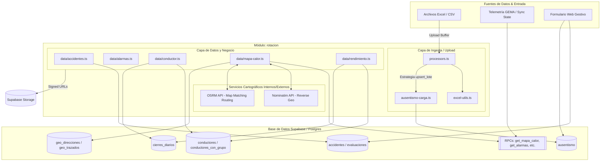

# Documentación Técnica del Módulo: rotacion

## 1. Visión General y Propósito

### Resumen Ejecutivo
El módulo **`rotacion`** es un componente del ERP/SaaS de transporte de pasajeros. Su propósito principal es gestionar y analizar el ciclo de vida, comportamiento operativo, rendimiento y riesgos asociados a los **conductores** (operadores) y a la **flotas de vehículos**. 

En la operación de transporte público y comercial, la rotación de personal, la siniestralidad (accidentabilidad), la deserción y los incumplimientos operativos (viajes perdidos) representan uno de los mayores costos indirectos y riesgos legales/operativos. Este módulo consolida la información proveniente de múltiples fuentes (sistemas telemetría/GEMA, recaudos por liquidadoras, formularios en tiempo real y cargas masivas desde Excel) para ofrecer:
* **Analítica de Rendimiento Operativo y Productividad:** Evaluación de pasajero/timbradas liquidadas vs. diferencias, días trabajados y evolución quincenal por grupos de antigüedad.
* **Gestión de Accidentabilidad y Reincidencia:** Registro de siniestros, evaluación técnica de responsabilidad (atribuible vs. tercero) y cálculo automático de reglas de reincidencia (3, 6 y 12 meses) para soporte en comités disciplinarios o de seguridad vial.
* **Geointeligencia y Mapa de Calor:** Telemetría integrada para visualizar subidas/bajadas de pasajeros por celdas geográficas (~110m), trazados GPS con ajuste a malla vial (OSRM), geocodificación inversa (Nominatim) y detección de anomalías (alarmas de registradora, reinicios de contador).
* **Control de Ausentismo e Incapacidades:** Seguimiento detallado de incapacidades médicas (EPS, CIE10, ARL), días IT pagados y protección de registros origen formulario vs. Excel.
* **Gestión de Perfil 360° del Conductor:** Integración de historial laboral, reingresos (cortes de antigüedad), grupo familiar, incentivos y viajes perdidos (VP).

### Responsabilidades Principales
1. **Consolidación ETL & Ingesta de Datos:** Normalización de archivos Excel y sincronización desde el backend de telemetría (GEMA) para conductores, cierres diarios, viajes perdidos, incapacidades e incentivos.
2. **Evaluación de Siniestralidad y Reincidencia:** Cálculo de ventanas temporales de reincidencia de accidentes atribuibles y generación de enlaces seguros (signed URLs) para firmas, audio-notas y evidencias fotográficas.
3. **Procesamiento de Telemetría y Alarmas:** Consulta mediante RPCs de Supabase para agregaciones masivas por hora, tipo de alarma (bloqueos, puertas, fallas), ruta, vehículo y conductor.
4. **Geocodificación y Map Matching:** Reconstrucción de trazados reales de ruta mediante APIs cartográficas y almacenamiento en caché de respuestas geográficas.

---

## 2. Arquitectura y Estructura de Archivos

### Archivos Analizados

| Ruta del Archivo | Rol en el Módulo | Propósito y Contenido Principal |
| :--- | :--- | :--- |
| `src/lib/rotacion/data/accidentes.ts` | Capa de Datos / Negocio | Consultas de accidentes de tránsito (Gestivo e Histórico GO-R-22), generación de URLs firmadas de Storage y derivación de contexto de evaluación (reincidencia y antigüedad). |
| `src/lib/rotacion/data/alarmas.ts` | Capa de Datos | Ingesta y estructuración de alarmas de registradora/telemetría (bloqueos, puertas, fallas). Llama a procedimientos almacenados RPC. |
| `src/lib/rotacion/data/conductor.ts` | Capa de Datos | Obtención de perfil integral de conductor (360°). Aplica fechas de corte por reingreso y consolida KPIs de rendimiento, viajes perdidos, ausentismo y familia. |
| `src/lib/rotacion/data/mapa-calor.ts` | Capa de Datos / Geoservicios | Agregación de eventos de abordaje/desembarque, velocidad, alarmas e itinerarios. Incluye geocodificación inversa (Nominatim) y ajuste de rutas a calles (OSRM). |
| `src/lib/rotacion/data/rendimiento.ts` | Capa de Analítica | Paginación masiva y agregación estadística por cohortes de antigüedad, quincenas operativas y matrices de evolución del conductor. |
| `src/lib/rotacion/upload/ausentismo-carga.ts` | ETL / Ingesta | Lógica de carga para la matriz de ausentismo con estrategia `upsert_lote`. Preserva datos de formularios web y gestiona catálogos de IPS/Profesionales. |
| `src/lib/rotacion/upload/excel-utils.ts` | Utilidades ETL | Funciones puras de parsing de hojas de cálculo: conversión de fechas Excel/ISO, sanitización de cédulas y mapeos de columnas. |
| `src/lib/rotacion/upload/processors.ts` | ETL / Procesadores | Mapeadores específicos por tipo de archivo Excel (`conductores`, `cierres`, `viajes_perdidos`, `ausentismo`, `reingresos`, `incentivos`, `familia`). |
| `src/lib/rotacion/upload/types.ts` | Definiciones / Configuración | Tipos TypeScript para el motor de carga y matriz `FILE_TYPE_CONFIG` con reglas de conflicto y políticas de habilitación de cargas. |
| `src/lib/rotacion/utils/constants.ts` | Constantes UI/Negocio | Etiquetas, colores de gráficos y clases de Tailwind asociadas a los rangos de antigüedad de conductores (`0-3m`, `3-6m`, `6-12m`, `1+a`). |
| `src/lib/rotacion/utils/excel-parser.ts` | Utilidades I/O | Utilidades de lectura de archivos Excel desde el sistema de archivos del servidor (NodeJS `fs`/`path`). |
| `src/lib/rotacion/utils/format.ts` | Formateadores | Funciones de presentación de moneda (COP), fechas en español (`es-CO`), números e iniciales de nombres. |

### Diagrama de Flujo Conceptual



---

## 3. Modelos de Datos y Entidades

### Interfaces y Tipos TypeScript Clave

#### 1. Accidentabilidad y Contexto Evaluativo (`data/accidentes.ts`)
```typescript
export type OrigenAccidente = "gestivo" | "historico";

export type ContextoEvaluacion = {
  mesesAntiguedad: number | null;
  antiguedad3aSinEventos: boolean; // Atenuante: >36 meses sin siniestros
  reincidencia3m: number;
  reincidencia6m: number;
  reincidencia12m: number;
  reincidente3m: boolean;        // Agravante: >=1 accidente atribuible en 3 meses
};
```

#### 2. Alarmas Operativas (`data/alarmas.ts`)
```typescript
export interface AlarmaEvento {
  fecha: string;
  hora: string;
  tipo: string; // 'BLOQUEO' | 'PUERTA' | 'FALLA'
  codigoVehiculo: string | null;
  placa: string | null;
  conductor: string | null;
  ruta: string | null;
  direccion: string | null;
  puntoVirtual: string | null;
  lat: number | null;
  lng: number | null;
}

export interface AlarmasData {
  desde: string;
  hasta: string;
  tipo: string | null;
  ruta: string | null;
  total: number;
  eventos: AlarmaEvento[];
  porTipo: AlarmaTipo[];
  porHora: AlarmaHora[];
  porVehiculo: AlarmaAgregado[];
  porConductor: AlarmaAgregado[];
  rutas: string[];
  ultimaFechaSync: string | null;
}
```

#### 3. Mapa de Calor y Analítica Geoespacial (`data/mapa-calor.ts`)
```typescript
export interface CeldaMapa {
  lat: number;
  lng: number;
  suben: number;
  bajan: number;
  puntoVirtual: string | null;
  velocidad: number | null;
}

export interface ViajeOpcion {
  numero: number;
  viaje: string | null;
  ruta: string | null;
  horaDespacho: string | null;
  horaLlegada: string | null;
  sinRecaudo: boolean;      // Detectado por GPS sin transacción de caja
  alarmas: number;
  reinicios: number;       // Reinicio de contador de registradora
  timbradasVr: number | null;
  descuentoVr: number | null;
  timbradasGps: number;    // Reconstrucción por diferencial de contador GPS
}
```

#### 4. Tipos de Carga Masiva (`upload/types.ts`)
```typescript
export type FileType =
  | "conductores_activos"
  | "conductores_retirados"
  | "cierres_diarios"
  | "viajes_perdidos"
  | "ausentismo"
  | "familia"
  | "reingresos"
  | "incentivos";

export interface FILE_TYPE_CONFIG {
  label: string;
  description: string;
  table: string;
  multiple: boolean;
  strategy: "upsert" | "delete_insert" | "periodo_replace" | "reingresos_update" | "upsert_lote";
  onConflict?: string;
  deshabilitado?: { motivo: string };
}
```

### Tablas y Vistas de Base de Datos

| Tabla / Vista / RPC | Operaciones Realizadas | Descripción de Negocio |
| :--- | :--- | :--- |
| `conductores` | SELECT, UPSERT, UPDATE | Registro maestro de conductores, estados, licencias y fechas de ingreso/retiro/reingreso. |
| `conductores_con_grupo` | SELECT (Vista) | Vista calculada que asigna el grupo de antigüedad (`0-3m`, `3-6m`, `6-12m`, `1+a`) y calcula `meses_antiguedad`. |
| `accidentes` | SELECT, INSERT, UPDATE, DELETE | Historico (matriz GO-R-22) y reportes en vivo de siniestros viales. |
| `accidente_vehiculos` | SELECT | Vehículos involucrados en un accidente. |
| `accidente_eventos` | SELECT | Bitácora de seguimiento/novedades del accidente. |
| `accidente_evaluaciones` | SELECT, MAYBE_SINGLE | Dictamen técnico de responsabilidad (directo, compartido, tercero). |
| `accidente_victimas` | SELECT | Lesionados o fallecidos asociados al evento. |
| `cierres_diarios` | SELECT, UPSERT | Consolidado diario de timbradas (pasajeros), viajes, liquidación individual vs. grupo. |
| `viajes_perdidos` | SELECT, INSERT, DELETE (por periodo) | Incumplimientos operacionales clasificados por tipología (Conductor, Vehículo, etc.). |
| `ausentismo` | SELECT, UPSERT, DELETE | Matriz de incapacidades médicas, días IT, diagnósticos CIE10 e IPS. |
| `ausentismo_catalogos` | SELECT | Maestro de IPS y Profesionales Médicos en proceso de verificación. |
| `familia` | SELECT, DELETE, INSERT | Composición del núcleo familiar (cónyuges e hijos). |
| `incentivos` | SELECT, DELETE, INSERT | Registro de bonificaciones, premios y pagos Plan Padrino. |
| `gema_sync_state` | SELECT | Estado de sincronización del motor de telemetría externo GEMA. |
| `geo_direcciones` | SELECT, UPSERT | Caché de direcciones legibles derivadas de latitud/longitud vía Nominatim. |
| `geo_trazados` | SELECT, UPSERT | Caché de trazados GPS ajustados a las calles mediante OSRM. |
| `get_alarmas` (RPC) | EXECUTE | Función Postgres que procesa las alarmas por rango de fechas, rutas y vehículos. |
| `get_mapa_calor` (RPC) | EXECUTE | Función Postgres que calcula subidas/bajadas y velocidad por celda geográfica. |
| `get_timbradas_periodo` (RPC) | EXECUTE | Agregación del recaudo bruto, descuentos y volumen de viajes. |

---

## 4. Reglas de Negocio y Lógica Crítica

### 1. Manejo de Antigüedad y Fechas de Reingreso
* **Regla:** Cuando un conductor es recontratado (`fecha_reingreso` no nula), el sistema **descarta** su historial operativo previo a esa fecha.
* **Aplicación:** En `getConductorProfile` (`data/conductor.ts`), las consultas a `cierres_diarios`, `viajes_perdidos`, `ausentismo` e `incentivos` aplican dinámicamente el filtro `gte('fecha', conductor.fecha_reingreso)` o `gte('periodo', fecha_corte)`.

### 2. Contexto Automático de Evaluaciones de Accidentabilidad
* **Regla de Atribuibilidad:** Un accidente previo afecta el récord del conductor **únicamente si no fue dictaminado como responsabilidad exclusiva de un tercero** (`responsabilidad !== 'tercero'`). Si el dictamen no existe aún o está en estudio, se asume provisionalmente como atribuible para cálculo de riesgo preventive.
* **Ventanas de Reincidencia:** Se calculan de forma retrospectiva desde la fecha del nuevo accidente hacia el pasado:
  $$\text{meses} = \frac{\text{fechaAccidente} - \text{fechaPrevio}}{1000 \times 60 \times 60 \times 24 \times 30.44}$$
  * `reincidente3m`: Marca verdadero si existen $\ge 1$ accidentes atribuibles en los últimos 3 meses.
  * `antiguedad3aSinEventos`: Atenuante automático si `mesesAntiguedad >= 36` y el histórico total de eventos atribuibles es $0$.

### 3. Matriz de Ausentismo y Protección de Datos Manuales (`ausentismo-carga.ts`)
* **Conflicto Formulario vs. Excel:** Prevalece lo capturado manualmente en la plataforma (`origen_registro = 'formulario'`) o los registros eliminados lógicamente (`eliminado_at IS NOT NULL`). La carga masiva vía Excel omitirá estas llaves.
* **Llave Natural:** Compuesta por `cedula | fecha_inicio | consecutivo_incapacidad`.
* **Cálculo de Días IT:** `diasEntre = (fechaFin - fechaInicio) + 1` días calendario. Si existe discrepancia con la columna del Excel, prevalece el cálculo por rango de fechas y se emite una advertencia.
* **Estrategia `upsert_lote`:** Estampa un id de `lote_carga`. Al finalizar sin errores, invoca `retirarExcelNoCargado()`, eliminando de la base de datos registros antiguos cargados por Excel que ya no vengan en el nuevo archivo (reemplazo seguro sin afectar datos capturados por web).

### 4. Reconstrucción de Viajes y Regla de Timbradas Netas
* **Diferencial de Registradora:** `timbradas_netas = timbradas_brutas - diff_tim`.
* **Reinicios de Contador:** En `data/mapa-calor.ts`, si la registradora física del vehículo se reinicia a cero durante una ruta, `timbradasVr` queda desfasado. La variable `timbradasGps` calcula la suma de avances reales por telemetría siendo inmune a reinicios.

### 5. Optimización Cartográfica y Geoservicios
* **Celdas del Mapa de Calor:** Se agrupan por coordenadas truncadas a 3 decimales ($\approx 110\,\text{m}$).
* **Caché y Throttling:**
  * **Nominatim:** Peticiones limitadas por concurrencia y cacheadas permanentemente en la tabla `geo_direcciones`.
  * **OSRM Routing:** Muestra tomada a máximo 25 puntos por viaje (`paso = ceil(longitud / 25)`) para evitar el error `TooBig` del API OSRM público. El trazado resultante se cachea en `geo_trazados`.

---

## 5. Puntos de Entrada y Funciones Principales

### Módulo `data/accidentes.ts`

```typescript
/** Obtiene lista paginada de accidentes por estado u origen. */
export async function getAccidentes(estado?: string, origen: OrigenAccidente = "gestivo")

/** Retorna conteo de accidentes por cada estado operativo e histórico. */
export async function getAccidenteStats(): Promise<Record<string, number>>

/** Retorna el detalle completo de un accidente con firmas y evidencias mediante URLs firmadas. */
export async function getAccidente(id: string)

/** Calcula antigüedad y reincidencia previa del conductor a la fecha del accidente. */
export async function getContextoEvaluacion(
  cedula: string | null,
  fechaAccidente: string,
  accidenteId: string
): Promise<ContextoEvaluacion>
```

### Módulo `data/alarmas.ts`

```typescript
/** Consulta eventos de alarma y agregados de telemetría en un rango de fechas. */
export async function getAlarmasData(params: {
  desde?: string;
  hasta?: string;
  tipo?: string;
  ruta?: string;
}): Promise<AlarmasData | null>
```

### Módulo `data/conductor.ts`

```typescript
/** Obtiene información básica de la tabla de conductores por cédula. */
export async function getConductorBasic(cedula: string)

/** Consolida el Perfil 360 del conductor aplicando cortes por reingreso. */
export async function getConductorProfile(cedula: string)
```

### Módulo `data/mapa-calor.ts`

```typescript
/** Genera la matriz de datos para el mapa de calor, trazado GPS y puntos virtuales. */
export async function getMapaCalorData(params: {
  desde?: string;
  hasta?: string;
  ruta?: string;
  punto?: string;
  vehiculo?: string;
  despacho?: string;
  hd?: string;
  hh?: string;
}): Promise<MapaCalorData | null>
```

### Módulo `data/rendimiento.ts`

```typescript
/** Calcula estadísticas globales, distribución por quincenas y matriz de evolución del personal. */
export async function getRendimientoData(fechaDesde?: string, fechaHasta?: string)
```

### Módulo `upload/ausentismo-carga.ts`

```typescript
/** Filtra los registros que no deben sobreescribirse por estar protegidos desde la web. */
export async function separarFilasDelFormulario(db: Db, records: Fila[])

/** Inserta o actualiza un lote de ausentismo marcando su identificador de lote. */
export async function cargarLoteAusentismo(db: Db, records: Fila[], lote: string, onConflict: string)

/** Borra del origen 'excel' los registros que no se incluyeron en el último lote subido. */
export async function retirarExcelNoCargado(db: Db, lote: string): Promise<number>
```

### Módulo `upload/processors.ts`

```typescript
export function processConductores(data: ArrayBuffer | Uint8Array, estado: "ACTIVO" | "RETIRADO" | "SUSPENDIDO"): ProcessResult
export function processCierres(data: ArrayBuffer | Uint8Array, fileName: string): ProcessResult
export function processViajesPerdidos(data: ArrayBuffer | Uint8Array, fileName: string): ProcessResult
export function processAusentismo(data: ArrayBuffer | Uint8Array, fileName: string): ProcessResult
export function processReingresos(data: ArrayBuffer | Uint8Array): ProcessResult
export function processIncentivos(data: ArrayBuffer | Uint8Array, fileName: string): ProcessResult
export function processFamilia(data: ArrayBuffer | Uint8Array): ProcessResult
```

---

## 6. Integraciones y Dependencias

### Integración con Supabase
* **Supabase Client / Admin Client:** Uso de `@/lib/supabase/admin` (`createAdminClient`) para consultar las tablas que requieren ignorar RLS en procesos de servidor y para la firma de archivos privados en Storage.
* **Supabase Storage:** Bucket `accidentes` utilizado para almacenar evidencias:
  * Firma Conductor (`firma_conductor_url`)
  * Firma Tercero (`firma_tercero_url`)
  * Arreglo / Compromiso (`arreglo_firma_url`)
  * Nota de Voz (`nota_voz_url`)
  * Fotografías del Siniestro (`fotos`)
  * Croquis de Tránsito (`croquis_path`, `ipat_croquis`)
* **PostgREST Pagination Limit:** Manejo explícito de la restricción de 1,000 filas por consulta de PostgREST mediante bucles paginados dinámicos (`range(desde, desde + 999)`).

### Integraciones Externas (APIs REST)
1. **OpenStreetMap / Nominatim API:**
   * **Endpoint:** `https://nominatim.openstreetmap.org/reverse`
   * **Función:** Geocodificación inversa para obtener nombres de calles/barrios cuando una celda del mapa de calor carece de Punto Virtual registrado en GEMA.
   * **Timeout:** 4,000 ms.
2. **OSRM (Open Source Routing Machine) API:**
   * **Endpoint:** `https://router.project-osrm.org/route/v1/driving/`
   * **Función:** Map matching / Ajuste de trazados GPS a la malla vial real.
   * **Timeout:** 6,000 ms.

### Dependencias de Bibliotecas (npm)
* **`xlsx` (SheetJS):** Parseo y lectura de archivos Excel (`.xlsx`, `.xls`) en entornos Node.js y navegadores.
* **`@supabase/supabase-js`:** Cliente oficial para consultas de datos, ejecución de procedimientos RPC y Storage.