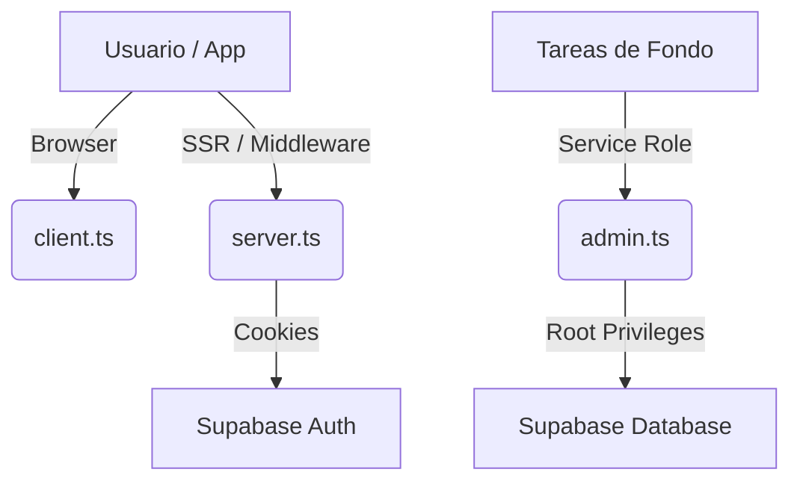

Como arquitecto de software, he analizado el módulo `supabase` de tu arquitectura. Este módulo actúa como la **capa de abstracción de persistencia** y el motor de conectividad entre el front-end (Next.js) y el backend de datos (Supabase).

A continuación, presento la documentación técnica estructurada:

---

# Documentación del Módulo: supabase

## 1. Visión General y Propósito
El módulo `supabase` centraliza la gestión de conexiones y la autenticación con la plataforma Supabase. En un sistema ERP/SaaS de transporte, su objetivo es garantizar una comunicación segura y eficiente entre las distintas capas de la aplicación (Cliente, Servidor, Tareas Administrativas).

**Responsabilidades principales:**
*   **Gestión de sesiones:** Persistencia de estado de usuario mediante cookies.
*   **Escalado de privilegios:** Diferenciación entre acceso público (usuario final) y administrativo (backend seguro).
*   **Seguridad:** Centralización de claves de acceso y configuración de transporte de datos.

## 2. Arquitectura y Estructura de Archivos

| Archivo | Rol | Propósito |
| :--- | :--- | :--- |
| `admin.ts` | Backend/Admin Client | Proporciona acceso total (Service Role) para operaciones que saltan las políticas RLS. |
| `client.ts` | Browser Client | Gestión de estado y peticiones desde el lado del cliente (Navegador). |
| `server.ts` | SSR Client | Gestión de peticiones dentro de Server Components y Middleware. |

### Diagrama de Flujo de Conexión

## 3. Modelos de Datos y Entidades
Este módulo no define modelos de negocio per se, sino que prepara el **SDK** para interactuar con las tablas del ERP (ej: `viajes`, `unidades`, `conductores`, `clientes`).

*   **Interfaces Clave:** Al ser una librería de utilidad, utiliza internamente las interfaces provistas por `@supabase/supabase-js` y `@supabase/ssr`.
*   **Interacción:** El cliente resultante permite operaciones CRUD sobre tablas de Postgres mediante `client.from('nombre_tabla')`.

## 4. Reglas de Negocio y Lógica Crítica
*   **Auto-gestión de Cookies (`server.ts`):** Utiliza `next/headers` para inyectar/actualizar cookies automáticamente, crucial para mantener la sesión del usuario en el servidor sin recargas.
*   **Bloqueo de Persistencia (`admin.ts`):** Se deshabilita `persistSession` y `autoRefreshToken` para evitar fugas de memoria o problemas de seguridad en entornos de ejecución con privilegios elevados.
*   **Manejo de Errores (Silencioso):** El bloque `try/catch` en `setAll` dentro de `server.ts` está diseñado para prevenir errores cuando se ejecutan acciones de servidor que intentan modificar cabeceras de respuesta cuando ya han sido enviadas.

## 5. Puntos de Entrada y Funciones Principales

### `createAdminClient()`
*   **Propósito:** Crear un cliente con privilegios de administrador.
*   **Retorno:** Instancia de `SupabaseClient` con Service Role Key.
*   **Uso:** Procesos Batch, reportes complejos, o tareas de limpieza de datos en el ERP.

### `createClient()` (Client Side)
*   **Propósito:** Cliente para el navegador.
*   **Retorno:** Instancia configurada para `NEXT_PUBLIC_SUPABASE_ANON_KEY`.

### `createClient()` (Server Side)
*   **Propósito:** Cliente para Server Components o Middleware.
*   **Retorno:** Promesa que resuelve a un `SupabaseClient` sincronizado con las cookies de la petición.

## 6. Integraciones y Dependencias
*   **Supabase Auth/Database:** El backend principal del ERP.
*   **Next.js (App Router):** Dependencia obligatoria en `server.ts` para el acceso a `cookies`.
*   **Variables de Entorno:** Requiere estrictamente:
    *   `NEXT_PUBLIC_SUPABASE_URL`
    *   `NEXT_PUBLIC_SUPABASE_ANON_KEY`
    *   `SUPABASE_SERVICE_ROLE_KEY` (Solo para admin).

---
**Nota de Arquitecto:** Para futuras iteraciones, se recomienda tipar las respuestas de Supabase utilizando `Database` generado por el CLI de Supabase para asegurar que el sistema de transporte tenga seguridad de tipos estricta en las consultas SQL.