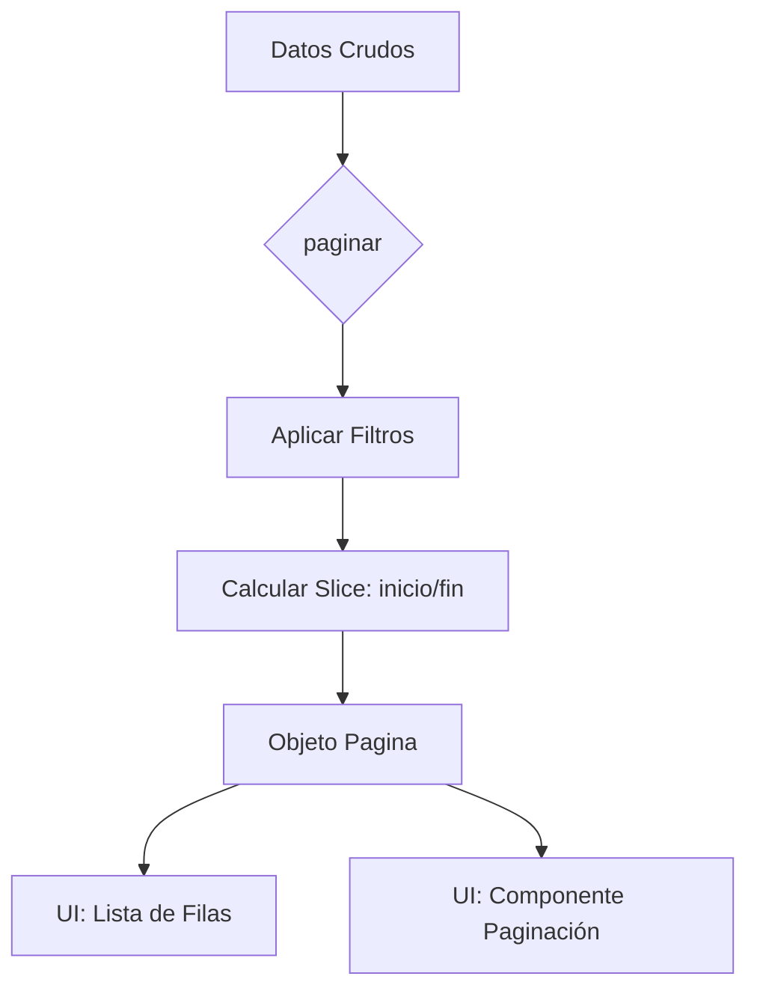

Como arquitecto de software senior, he analizado el módulo `tabla` del sistema de transporte. A continuación, presento la documentación técnica estructurada.

---

# Documentación del Módulo: tabla

## 1. Visión General y Propósito
El módulo `tabla` es una biblioteca de utilidad de infraestructura diseñada para estandarizar el manejo de datos tabulares en el front-end del sistema SaaS/ERP. Su propósito es abstraer la lógica compleja de filtrado, paginación y navegación de grandes volúmenes de datos operativos (como listas de vehículos, conductores, viajes o facturas), garantizando una experiencia de usuario consistente y un rendimiento óptimo.

**Responsabilidades:**
*   **Procesamiento de datos:** Implementación de filtrado flexible (textual y numérico).
*   **Gestión de estados de visualización:** Cálculo matemático de paginación y segmentación de datos.
*   **UI Helpers:** Generación de lógica para componentes de paginación (índices saltados).

---

## 2. Arquitectura y Estructura de Archivos

| Archivo | Rol | Propósito |
| :--- | :--- | :--- |
| `filtros.ts` | Lógica de Negocio (Pure Utils) | Contiene algoritmos para normalización de texto y evaluación de filtros numéricos complejos. |
| `paginacion.ts` | Lógica de Presentación (Pure Utils) | Maneja el cálculo de offsets, límites de página y generación de rangos de navegación. |

### Diagrama de Flujo (Lógica de Paginación)

---

## 3. Modelos de Datos y Entidades

### Interfaces Clave
*   **`Pagina<T>`**: Es la estructura de respuesta estándar tras aplicar la paginación.
    *   `filas`: Datos segmentados.
    *   `pagina`: Índice de página actual (1-based).
    *   `totalPaginas`: Límite superior.
    *   `total`: Conteo total de ítems antes de la paginación.
    *   `desde/hasta`: Indicadores de rango visual para el usuario final.

---

## 4. Reglas de Negocio y Lógica Crítica

### Filtrado Textual
*   **Normalización:** Se aplica `NFD` para eliminar tildes y caracteres especiales, convirtiendo todo a mayúsculas. Esto asegura que búsquedas como "Camión" coincidan con "CAMION".
*   **Multicampo:** La función `coincideTexto` permite buscar un término en múltiples columnas simultáneamente utilizando el operador `OR`.

### Filtrado Numérico (DSL Simplificado)
El sistema soporta una sintaxis robusta para consultas de usuario:
*   **Rangos:** Soporta el formato `N..M` (ej: `100..200`).
*   **Umbrales:** Soporta `±N` (valor absoluto >= N).
*   **Operadores relacionales:** Soporta `<`, `>`, `<=`, `>=`, `!=`, `<>`.
*   **Nulos:** Interpretación de palabras clave `vacío`, `-`, `null` como filtro de valores nulos.

### Paginación
*   **Seguridad:** Los límites de página se fuerzan entre `1` y `totalPaginas` para evitar errores de índices fuera de rango.
*   **Representación:** `paginasVisibles` implementa una lógica de "truncamiento inteligente" que inserta `null` para representar elipsis (`...`), mejorando la UX en tablas con cientos de páginas.

---

## 5. Puntos de Entrada y Funciones Principales

### `filtros.ts`
*   `coincideTexto(filtro: string, ...campos: (string | null)[])`: Retorna `true` si el filtro está contenido en cualquier campo.
*   `pasaFiltroNumero(expr: string, v: number | null)`: Evalúa si un valor numérico cumple con una expresión compleja definida por el usuario.

### `paginacion.ts`
*   `paginar<T>(items: T[], pagina: number, porPagina: number)`: Función core que realiza el slicing de datos.
*   `paginasVisibles(actual: number, total: number)`: Devuelve un arreglo de números y `null` para renderizar los botones de la paginación.

---

## 6. Integraciones y Dependencias
*   **Independencia:** El módulo es 100% agnóstico al framework y no depende de librerías externas (solo TypeScript puro).
*   **Uso:** Este módulo debe ser consumido por los componentes de React (`src/components/ui/table`) para procesar los datos provenientes de **Supabase** antes de que el usuario los visualice.
*   **Extensibilidad:** Al ser puramente lógico, es altamente testeable mediante `Vitest` o `Jest` (se recomienda mantener el enfoque de funciones puras sin efectos secundarios).